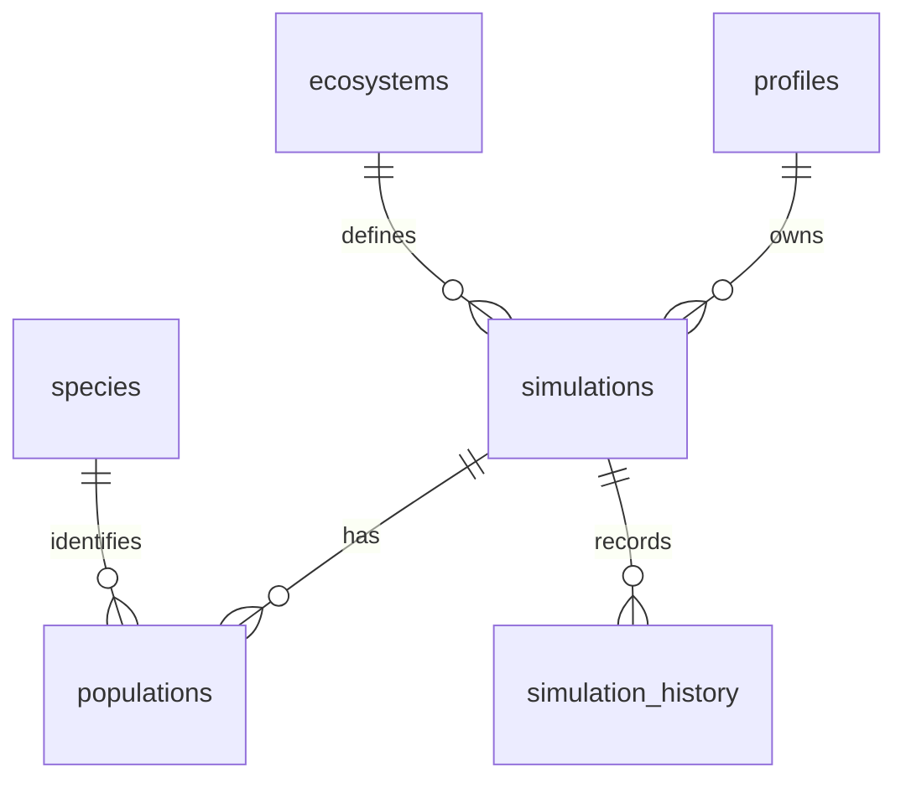

# BioWorld — Долината на равновесието

**Идея и план за екип от двама ученици**  
**Хранилище:** https://github.com/ilia331/BioWorld  
**Статус:** концепция и план; описаните функции не са представени като вече реализирани.

## Идея и образователна цел

Играчът е млад пазител на речна долина след няколко сухи сезона. За **10 последователни хода** той трябва да запази жизнеспособни три вида — **трева, зайци и лисици** — и ограничен запас от вода. На ход може да засади трева, да възстанови водоем, да добави зайци или лисици, или да остави долината без намеса. След действието настъпва събитие като дъжд, суша или болест. Целта е да се разбере защо популациите се променят, а не просто да се натрупат възможно най-много животни.

Отличителният елемент е **„Дневник на причините“**. Преди всеки ход ученикът прави прогноза, а след него сравнява очакването си с резултата и вижда кратка причинна верига: „Малко вода → по-бавен растеж на тревата → по-малко храна за зайците → риск и за лисиците“. Това е опростен учебен модел, а не точна научна прогноза за истинска екосистема.

Играта е за ученици от **6. до 9. клас**. Помага им да изследват хранителни вериги, ограничени ресурси, популации и последствия от човешка намеса. Учителят може да използва една кратка мисия и да поиска обяснение на решение. Успехът се проверява чрез ясни условия за 10 хода, графика и обяснение от ученика за поне една промяна.

## Пет мисии

| Мисия | Ситуация и учебна цел | Условие за успех |
| --- | --- | --- |
| 1. Първи живот | Трева, зайци и лисици; основна хранителна верига | И трите вида оцеляват 10 хода |
| 2. Пресъхналият поток | Малко вода забавя растежа | Водата остава над зададен праг |
| 3. Твърде много зайци | Пренаселване и недостиг на трева | Тревата и зайците остават жизнеспособни |
| 4. Изчезващият хищник | Болест намалява лисиците | И трите популации се стабилизират |
| 5. Непредвидима година | Редуват се дъжд, суша и болест | Балансът се запазва въпреки събитията |

Първата мисия е малкият работещ продукт. Другите четири използват същия механизъм с различни начални стойности, събития и критерии, вместо да се правят пет отделни игри.

## Функции на крайния продукт

1. Начално меню, правила и избор на една от петте мисии.
2. Игрови екран с долина и видими стойности за трева, зайци, лисици и вода.
3. Избор на действие, проверка на цената му и бутон „Следващ ход“.
4. Собствен алгоритъм за растеж, хранене, хищничество и природни събития.
5. Графики по ходове и „Дневник на причините“.
6. Прогноза преди ход и сравнение с резултата.
7. Записване и зареждане на напредъка през Supabase.
8. Вход, регистрация, ясни грешки и адаптивен интерфейс за телефон.

**Потребителски истории:** Като ученик искам да прочета правилата преди мисия; да видя цената на действието; да предскажа промяната; да сравня прогнозата с графиката; да продължа записана игра. Като учител искам учениците да могат да обяснят причините за резултата.

## Собствен алгоритъм за един ход

**Вход:** популации на трева P, зайци H и лисици C; вода W; избрано действие; природно събитие; настройки на мисията. **Изход:** нови стойности, запис за графиката и конкретни причини за промените.

1. Проверява се дали действието е разрешено и дали има достатъчно ресурс. При невалидно действие нищо не се променя.
2. Прилагат се действието и събитието към водата; тя остава между 0 и зададен максимум.
3. Растежът на тревата зависи от водата и свободното място до максималната вместимост. Зайците изяждат част от тревата.
4. Зайците се увеличават при достатъчно трева; намаляват при глад и според броя на лисиците.
5. Лисиците се увеличават само при достатъчно зайци; иначе намаляват. Болестта добавя загуба за засегнатия вид.
6. Стойностите се закръглят до цели числа, ограничават се до 0 и максимум, а задействаните правила се записват в дневника. **Всички зависимости ползват стойностите от началото на хода**, за да не влияе редът на смятане на резултата.

Гранични случаи: при нула вода тревата не расте; при нула зайци лисиците не се размножават; никоя популация не става отрицателна. С три вида сложността е **O(1) на ход**. Първо ще има три ръчни проверки (нормална година, суша, липса на плячка), после проверка на **10 поредни хода**. До четвъртата седмица ще има поне 10 автоматизирани тестови случая. Параметрите ще бъдат видими и обясними в кода.

## Екрани и дизайн

**Екран 1 — мисии:** заглавие, кратки правила, пет карти с цел и трудност, „Започни“ и „Продължи“. Ученикът знае целта, преди да играе.

**Екран 2 — долина:** проста 2D сцена с трева, зайци, лисици и водоем; четири брояча, действия и бутон „Следващ ход“. Под тях стоят прогнозата, графиката и дневникът. На телефон панелите се подреждат вертикално.

**Екран 3 — резултат:** след 10 хода показва условията, графиката, ключовите решения и въпроси за размисъл.

За първия етап ще се създадат **две действителни скици или макета**. Това текстово описание не ги замества.

## Технологии и база данни

- **HTML5, CSS3, JavaScript ES6+** за интерфейс и собствена логика.
- **Supabase: PostgreSQL, Auth и RLS** за профили и личен напредък; всеки вижда само своите записи.
- **Chart.js** за четими популационни графики. Сцената може да се направи със собствен HTML/CSS и SVG; Phaser не е нужен за първия вариант.
- **Vitest** за автоматизирани проверки на алгоритъма.
- **GitHub Pages** за публикуване на статичния интерфейс. Секретни ключове не се качват; публичният Supabase ключ изисква правилни RLS политики.

| Таблица | Основни полета | Връзки |
| --- | --- | --- |
| profiles | id uuid PK, display_name text | id → auth.users.id |
| species | id uuid PK, name text, role text | използва се от populations |
| ecosystems | id uuid PK, title text, initial_water integer | използва се от simulations |
| simulations | id uuid PK, user_id uuid FK, ecosystem_id uuid FK, mission_no integer, turn_no integer, water integer | собственик и среда |
| populations | simulation_id uuid FK, species_id uuid FK, count integer; съставен PK от двата FK | стойности за видовете в една игра |
| simulation_history | id uuid PK, simulation_id uuid FK, turn_no integer, snapshot jsonb, reason text | история на ходовете |

Числовите стойности ще имат ограничения за неотрицателни числа, а историята — уникалност на (simulation_id, turn_no). В database/schema.sql ще се опишат типовете, външните ключове и RLS: симулациите, популациите и историята са достъпни само за собственика; видовете и публикуваните мисии са само за четене.

## Три сходни решения

| Решение | Функции и силна страна | Ограничение за нашата цел и собствена идея |
| --- | --- | --- |
| [PhET Natural Selection](https://phet.colorado.edu/en/simulations/natural-selection) | Експерименти със зайци и фактори на средата; нагледно показва оцеляването | Фокусира се върху подбор, а не управление на хранителна верига. Ще направим собствен модел за три вида с видими причини. |
| [The Habitable Planet — Ecology Lab](https://www.learner.org/wp-content/interactive/envsci/ecology/) | Изграждане на екосистема и изследване на връзки между видове | За нашата възрастова група ще добавим кратки мисии и проверка на прогноза след ход. |
| [Eco](https://www.play.eco/) | Богата екологична симулация и решения с последствия | Мащабът е голям за петседмичен училищен проект. Ще използваме идеята за действия с цена и дългосрочен ефект в малка долина. |

**Разлика:** BioWorld е кратка игра на български за 6.–9. клас. Всяко действие се свързва с прогноза, графика и разбираемо обяснение. Не копираме чужд код, изображения, дизайн или правила.

## Осем стъпки с редуване

„Аз“ е ученикът, който подава тази заявка, а „Партньор“ е другият ученик. Имената ще бъдат добавени от двамата. **Водещият прави собствен commit; другият преглежда и задава въпроси.** След всяка стъпка ролите се разменят. И двамата участват в интеграцията и трябва да могат да обяснят кода си.

| № | Седмица | Водещ | Готов резултат |
| --- | --- | --- | --- |
| 1✅ | 1 | Павел | docs/RESEARCH.md с три проверени решения, проблем, целева група, пет истории и източници |
| 2✅ | 1 | Илия | docs/PROJECT_PLAN.md, docs/GAME_DESIGN.md, два реални макета, начална ER диаграма и поне 12 разпределени GitHub Issues |
| 3✅ | 2 | Павел | Начални HTML/CSS екрани, навигация и мобилен изглед; отварят се без грешки |
| 4✅ | 2 | Илия | database/schema.sql, поне три свързани таблици, тестови данни и RLS; чужд запис не се вижда |
| 5 | 3 | Павел | Игров екран, избор и проверка на действията, ясни състояния и демонстрация на интерфейса |
| 6 | 3–4 | Илия | Собствен алгоритъм и първа завършена мисия с 10 хода, запис/зареждане, три ръчни примера и поне 10 автоматизирани теста |
| 7 | 4–5 | Павел | Останалите четири мисии, графика, дневник, резултат и проверка на телефон с реален потребител |
| 8 | 5 | Илия | Интеграция, поправки, проверки на права и крайни случаи, публикувано демо и презентация 10–12 слайда |

**Още през първата седмица:** допълнете README.md с истинските имена, добавете начална структура и приложимите index.html, style.css, script.js. Всеки трябва лично да направи поне един commit. Създайте WEEK_1_REPORT.md с действително свършеното, неизпълненото и причините, проблемите, следващите три задачи и два отделни индивидуални отчета. Запишете и за какво е използван ИИ, примерна заявка, получения резултат и как е проверен и променен. За Classroom се предават отделно поисканите RESEARCH, PROJECT_PLAN, две скици, ER диаграма, отчет и линк към репото. Този общ план не ги замества. Пълната документация, AI_USAGE.md, TESTS.md, SOURCES.md, USER_GUIDE.md, лицензът и презентацията се довършват по графика.

**ИИ за този файл:** текстът и идеята са подготвени с помощта на ChatGPT по заявка за оригинална образователна игра и план за двама. Изискванията са сверени с предоставените задания, а адресите на трите решения са проверени. Учениците трябва да прегледат, редактират и могат да защитят всяко решение. Непопълнен личен принос или несъществуващ код не се представя за готов.
