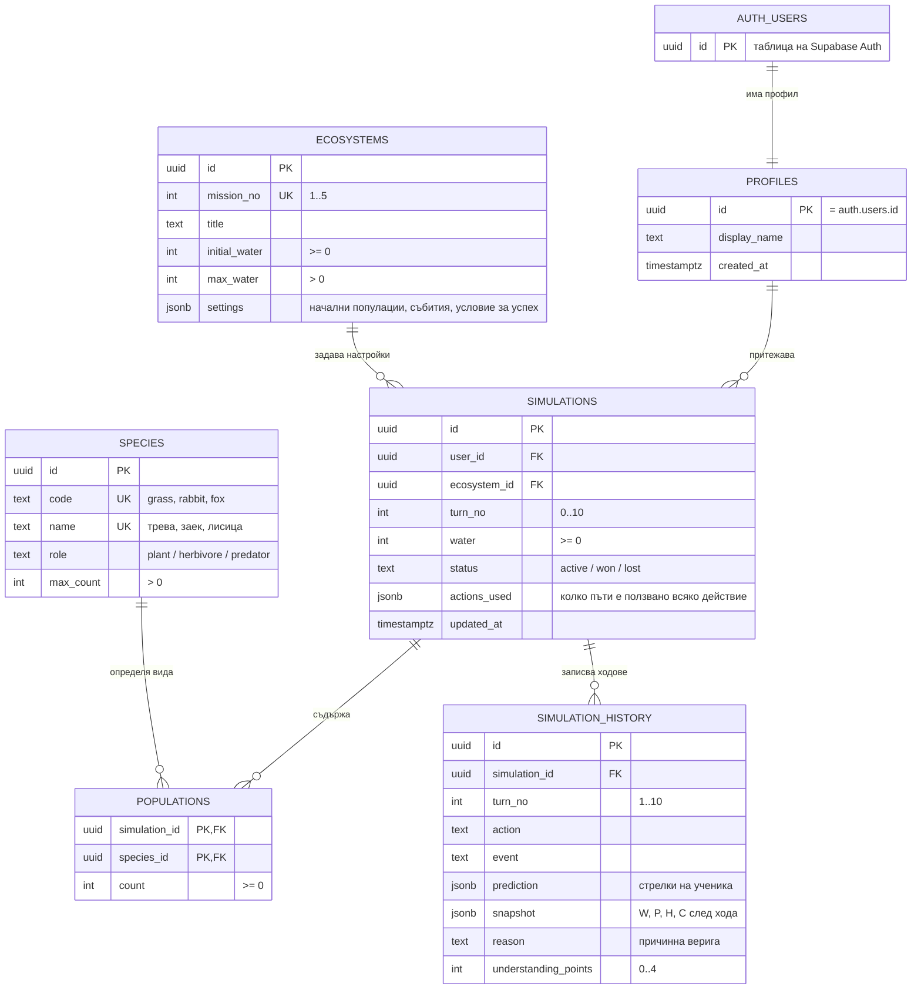

# BioWorld — Начална ER диаграма

**Статус:** начален проект (стъпка 2). В стъпка 4 моделът е реализиран в [database/schema.sql](../database/schema.sql).

**Промени спрямо началния проект (стъпка 4):**
- `species` има колона `code` (`grass`, `rabbit`, `fox`) — кратко име, което JavaScript кодът ще използва.
- `simulations` и `simulation_history` имат `created_at`.
- `species` и `ecosystems` се четат **и без вход**, за да се виждат мисиите на първия екран (виж таблицата с права по-долу).
- Изигран ход в `simulation_history` не може да се променя — само се добавя.

## Диаграма

GitHub показва Mermaid диаграмата като картинка.

## Таблици и връзки

| Таблица | За какво е | Ключове | Важни ограничения |
| --- | --- | --- | --- |
| profiles | Публична информация за ученика | PK `id` → FK към `auth.users.id` | Един профил на потребител |
| species | Видовете в играта | PK `id` | `name` уникално; `role` е една от 3 стойности |
| ecosystems | Настройките на 5-те мисии | PK `id` | `mission_no` уникално, между 1 и 5 |
| simulations | Една конкретна игра на ученик | PK `id`, FK `user_id`, FK `ecosystem_id` | `turn_no` между 0 и 10; `water` ≥ 0 |
| populations | Колко от всеки вид има в една игра | Съставен PK (`simulation_id`, `species_id`) | `count` ≥ 0 |
| simulation_history | Състояние и обяснение след всеки ход | PK `id`, FK `simulation_id` | Уникално (`simulation_id`, `turn_no`) |

**Връзки:**
- Един ученик (profiles) → много игри (simulations). **1:N**
- Една мисия (ecosystems) → много игри от различни ученици. **1:N**
- Една игра → по един ред в populations за всеки вид. Това е връзка **N:M** между simulations и species чрез populations.
- Една игра → до 10 реда в simulation_history. **1:N**

При изтриване на игра трябва да се изтрият и нейните populations и history (`ON DELETE CASCADE`).

## Права (RLS) — план

| Таблица | Четене | Писане |
| --- | --- | --- |
| profiles | само собственият профил | само собственият профил |
| species, ecosystems | всички, и без вход | никой от приложението (само администратор) |
| simulations | само ако `user_id = auth.uid()` | само ако `user_id = auth.uid()` |
| populations | само ако играта е на `auth.uid()` | добавяне и промяна, само ако играта е на `auth.uid()` |
| simulation_history | само ако играта е на `auth.uid()` | само добавяне, ако играта е на `auth.uid()` |

Проверка в стъпка 4: два тестови акаунта. Акаунт Б **не трябва** да вижда игрите на акаунт А.

## Въпроси за обсъждане

1. Да пазим ли водата в `simulations.water` или да я направим „вид“ в `populations`? Предложение: отделна колона, защото водата не е вид.
2. Да пазим ли и непълни (изоставени) игри? Предложение: да, със `status = 'active'`. Така работи бутонът „Продължи“.
3. Трябва ли `ecosystems.settings` да е JSON или отделни колони? JSON е по-гъвкав за различните мисии, но е по-труден за проверка.
